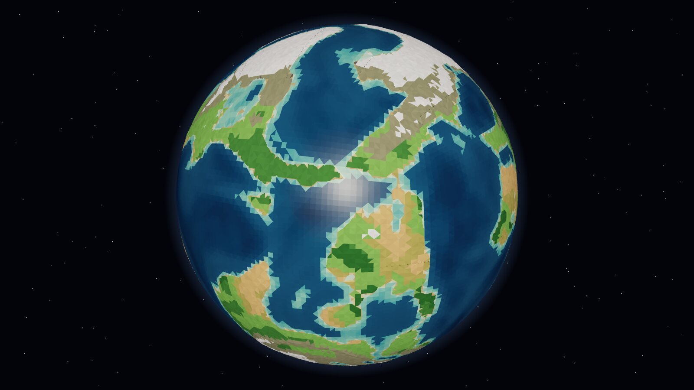
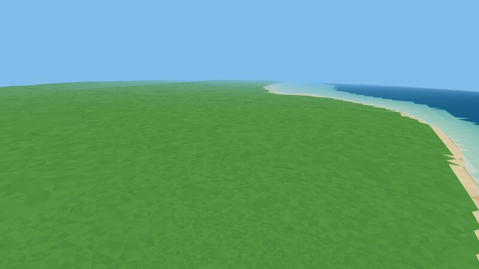
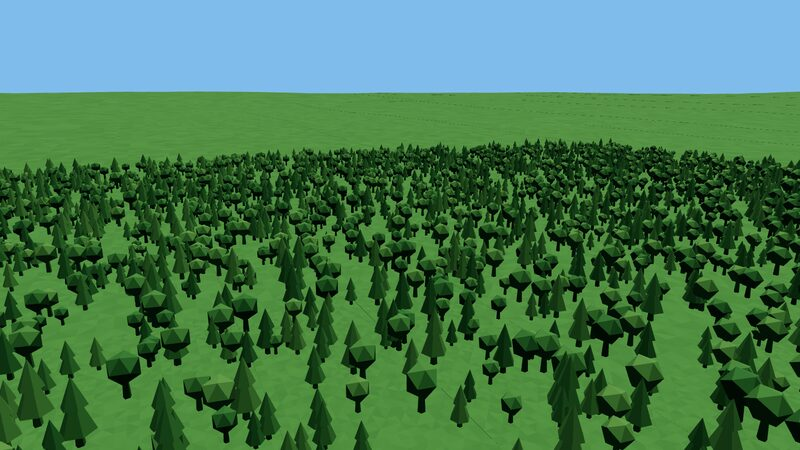
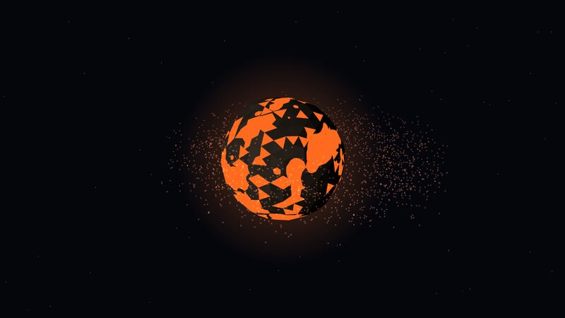
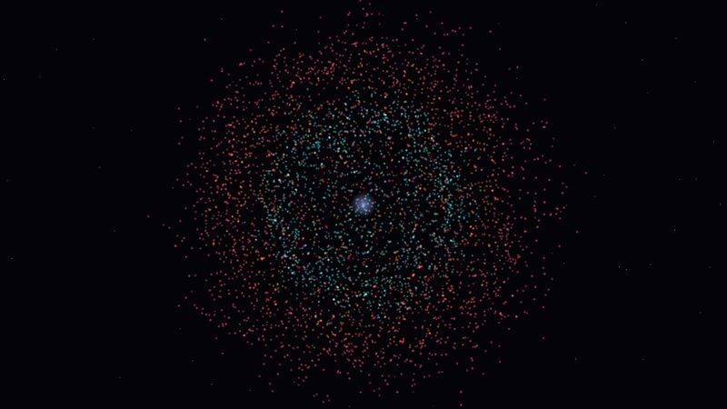
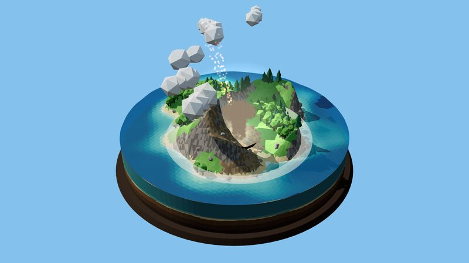
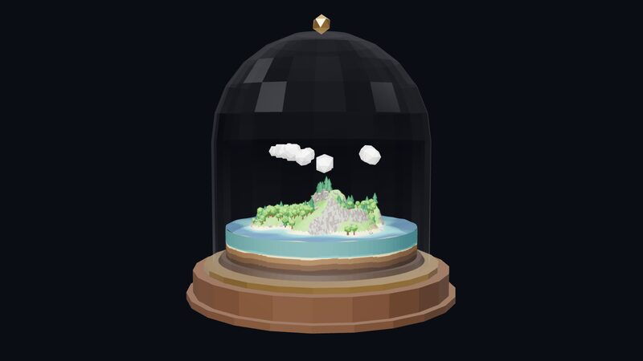

<p align="center">
  
</p>

<h1 align="center">Clinamen</h1>

<p align="center">
  <b>A universe shaped by chance.</b><br>
  An open-source universe simulator where worlds are built from hydrogen by rare accidents.<br>
  Explore yours from orbit down to the forest floor, right in your browser.
</p>

<p align="center">
  <a href="https://clinamen.deep-mehak003.workers.dev"><b>▶ Play in your browser</b></a>
  &nbsp;·&nbsp; <a href="#what-works-today">What works today</a>
  &nbsp;·&nbsp; <a href="docs/DESIGN.md">Design</a>
  &nbsp;·&nbsp; <a href="docs/STORY.md">Story mode</a>
</p>

<p align="center">
  <a href="LICENSE"></a>
  
  
  
</p>

---

## Why "Clinamen"

Two thousand years ago, Epicurus and later Lucretius imagined atoms falling
straight through the void. Falling side by side, they would never meet, and
nothing would ever exist. Except that, now and then, one atom **swerves**, a
tiny amount, by pure chance. It collides with another, and from that collision
comes everything.

They called the swerve the **clinamen**.

Earth is a chain of swerves like that: a planet-sized impact that gave us the
Moon, icy asteroids that may have brought the oceans, one cell that swallowed
another and started all complex life, an asteroid that ended the dinosaurs.
Take any one away and the world turns out completely different.

**Clinamen lets you run that history yourself.**

## What makes it different

**🎲 Accidents, not powers.**
Most god games hand you meteors and lightning bolts. Clinamen hands you the rare
events that shaped real worlds. You can make one happen, choose *when*, or
leave it to fate's dice. Timing matters: bring water too early and it boils
away into space.

**🔭 Real laws, game resolution.**
The sun's position comes from the real date. Star colours come from their
surface temperature. Glowing gas uses the real colours of hydrogen, helium and
oxygen. The plan is real equations (heat, water, gravity) on coarse grids, so
the world behaves like a world, not a script.

**🌍 A whole planet to explore.**
Zoom seamlessly from space to a continent, to a coastline, to a single forest,
with no loading screens. Click anywhere and the camera flies there. Every seed
is a different world.

**🖥️ A world that lives on your desktop.**
Wallpaper mode lets a camera drift over your world like a nature documentary,
or pin your favourite place. It's built to run all day: low frame rate, paused
when hidden.

## A look around

| | |
|:-:|:-:|
|  |  |
| A coastline from 45 km up | Down in the forest |
|  |  |
| The moon-forming impact | A supernova scattering oxygen (teal) and hydrogen (red) |
|  |  |
| An asteroid strike: dust, shockwave, crater | A living terrarium, built in Blender |

## What works today

Clinamen is early. Here's an honest map.

**Working now**
- ✅ An Earth-sized procedural planet with continents, oceans, mountains and polar ice
- ✅ Seamless zoom from 21,000 km to 30 m above the ground (cube-sphere level of detail)
- ✅ Biomes from latitude, height and moisture, with trees near the ground
- ✅ The real sun: the day/night line moves with your clock
- ✅ Camera: drag, zoom, turn, click to fly, a director that wanders on its own
- ✅ Pinned wallpaper links
- ✅ Animated accident events: water from space, the moon-forming impact, an asteroid strike, life starting
- ✅ Cosmic assets: a hydrogen cloud collapsing into stars, star ignition, supernovae
- ✅ Accident tree icons and a Blender asset pipeline
- ✅ A first upgrade prototype with a 2-day undo (on the island page)

**Coming next** (see the [roadmap](docs/DESIGN.md#13-roadmap))
- 🚧 Accidents on the planet, with windows, fate rolls and timing
- 🚧 Land made by the simulation: plates, volcanoes, erosion
- 🚧 Weather and water physics
- 🚧 Creatures with genes, evolving bodies and brains, which you can follow
- 🚧 Story mode: *The Archivist*
- 🚧 The "living terrarium" wallpaper and a desktop app

## Story mode: The Archivist

> *The record of a world called Earth is damaged. You are an Archivist. You can
> re-run the universe from its first moment. Rebuild how Earth came to be, one
> accident at a time. But every run is different, and fate does not always agree.*

Eight chapters, from the first star to the first telescope. Every chapter
teaches one idea, every outcome is part of the story, and at the end the
Archive records *your* Earth. Read the full outline in [STORY.md](docs/STORY.md).

## Try it

**In your browser:** [clinamen.deep-mehak003.workers.dev](https://clinamen.deep-mehak003.workers.dev)

**Locally:**

```bash
git clone https://github.com/mrandhawa14/clinamen.git
cd clinamen
npm install
npm run dev
```

**Controls:** drag to move · scroll to zoom · right-drag to turn and tilt ·
click to fly there · `W` `A` `S` `D` to pan · `H` hides the panel

**Link options**

| Option | Example | What it does |
|---|---|---|
| `seed` | `?seed=yourname` | Same seed, same world, for everyone |
| `mode=wallpaper` | `?mode=wallpaper` | Hide the panel and let the director wander |
| `view` | `?view=19,12,45,70` | Pin a spot: latitude, longitude, height in km, heading |
| `date` | `?date=2026-12-21T12:00Z` | Freeze the sun at a moment |

Other pages: [`/assets`](https://clinamen.deep-mehak003.workers.dev/assets) shows every
procedural asset, [`/island`](https://clinamen.deep-mehak003.workers.dev/island) the
first diorama prototype.

### Use it as your wallpaper

- **Mac:** [Plash](https://github.com/sindresorhus/Plash) shows any web page as your desktop. Use a link with `?mode=wallpaper`.
- **Windows:** [Lively Wallpaper](https://github.com/rocksdanister/lively) or Wallpaper Engine.

## How it works

- **Rendering:** [three.js](https://threejs.org) (WebGL now, WebGPU compute planned for the simulation).
- **The planet:** a cube-sphere whose six faces are quadtrees. Chunks near the camera split into more detailed ones; far ones merge back. Vertices are stored relative to each chunk's centre, so precision holds metres above an Earth-sized planet.
- **Procedural everything:** terrain, biomes, trees, events and icons are generated from code and a seed, so worlds are small to store and easy to share.
- **Blender, from code:** `blender/build_assets.py` builds hand-designed pieces in Blender and exports glTF. Run `npm run assets:blender` to rebuild them.

```
src/planet/   the explorable planet (terrain, level of detail, camera, sky)
src/assets/   procedural accident events, cosmic assets, icons
blender/      Blender build script → public/models/*.glb
docs/         DESIGN.md (how the world works), STORY.md (story mode)
```

## FAQ

**Is it a game or a simulation?**
Both. The world runs on simple real-world rules; the game is choosing which
accidents happen and when. Strange outcomes, like a world without a moon, are
part of the fun.

**Do I need a powerful computer?**
No. It runs in a normal browser. The detail adapts to where you're looking, and
wallpaper mode keeps the frame rate low.

**Is the science real?**
The direction is real (giant-impact moon, stellar element forging, black-body
star colours), simplified for play. The design docs mark what's established,
what's still debated, and what's tuned for fun.

**Does it use AI-generated worlds?**
No. Every world comes from code and a seed, and the same seed always makes the
same world. AI world models are listed in the design doc as a possible optional
add-on, never the core.

**Why GPL?**
So Clinamen stays open. Anyone can use, study and change it, and anyone who
shares a modified version shares its source too.

## Contributing

Clinamen is built to grow in small pieces: a new **accident**, a new **law of
nature**, a new **asset**, a new **biome**. Each can be added without touching
the rest. Read [DESIGN.md](docs/DESIGN.md) for how modules and accidents fit
together, then open an issue with your idea.

By submitting a contribution, you agree that it is licensed under GPL-3.0 and
that the project owner may also license it under other terms.

## License

[GPL-3.0](LICENSE). If you distribute a modified Clinamen, its source must be
available under the same license.

---

<p align="center">
  <b>Every world is an accident. Go make one.</b><br>
  <a href="https://clinamen.deep-mehak003.workers.dev">▶ Play Clinamen</a>
</p>
